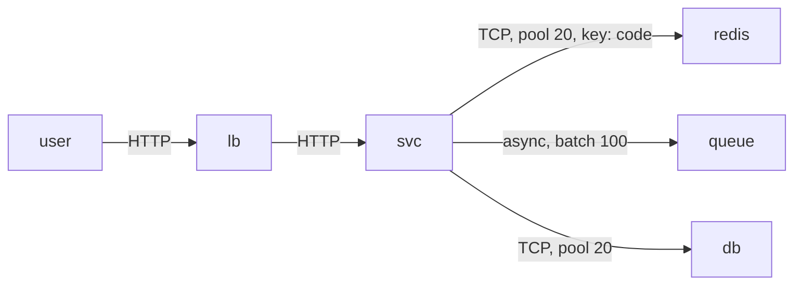

# shrnk.io — design

**Branch:** `template` · **Updated:** `2026-11-03 18:26` · **Success:** p99 < 20 ms @ 10k rps

## 1 · Requirements

| #   | Requirement | Target   |
| --- | ----------- | -------- |
| F1  |             |          |
| N1  |             | <number> |

Out of scope: <item> → saves <what>. Frozen on <date>.

## 2 · Entities

| table | columns (type) | constraints |
| ----- | -------------- | ----------- |
|       |                |             |

| index | query it serves |
| ----- | --------------- |
|       |                 |

Decisions: primary key · where expiry is evaluated · can a code be reused · what the DB enforces.

## 3 · API

| method | path | success | failures |
| ------ | ---- | ------- | -------- |
|        |      |         |          |

Non-200 bodies: <code → body → why>. Not idempotent: <which, and the cost>.

## 4 · Design

Bottleneck: <one sentence>.
Change on this branch: <one sentence> → <commit>.
Failure mode it introduces: <fill>.

## Numbers

|                 |     |
| --------------- | --- |
| p50 / p99 @ rps |     |
| throughput      |     |
| $/mo, hardware  |     |

## Open questions

<what this branch still cannot answer>
