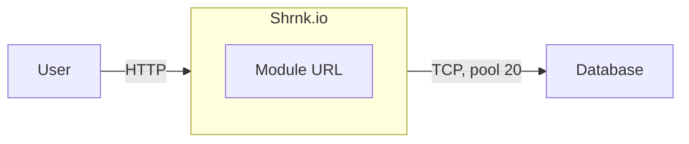

# shrnk.io — design

## 1 · Requirements

### Functional Requirment

| #   | Requirement                             |
| --- | --------------------------------------- |
| F1  | Create a short url from a original url  |
| F2  | Redirect to original url from short url |

### Non-functional Requirements

| #   | Requirement      | Target             |
| --- | ---------------- | ------------------ |
| N1  | Redirect latency | p99 < 20ms         |
| N2  | Create latency   | p99 < 100ms        |
| N3  | Availability     | 99.9% = 8.7 h/yr   |
| N4  | Durability       | 201 mean committed |
| N5  | Read:write       | 100:1              |

Out of scope:

- Privacy
- Analytics
- No user

## 2 · Entities

| column       | type        | constraints                                 |
| ------------ | ----------- | ------------------------------------------- |
| id           | int         | PK                                          |
| code         | varchar     | NOT NULL, UNIQUE                            |
| original_url | varchar     | NOT NULL                                    |
| expires_at   | timestamptz | NOT NULL, DEFAULT now() + interval '7 days' |
| created_at   | timestamptz | NOT NULL, DEFAULT now()                     |

| index          | query it serves                                                |
| -------------- | -------------------------------------------------------------- |
| links_code_key | SELECT id, original_url, expires_at FROM links WHERE code = $1 |

## 3 · API

| method | path               | success                      | failures                         |
| ------ | ------------------ | ---------------------------- | -------------------------------- |
| POST   | /url               | 201 return short url         | 400 return bad request           |
|        | body {originalUrl} |                              | 500 return internal server error |
| GET    | /:code             | 302 redirect to original url | 400 return bad request           |
|        |                    |                              | 404 return not found             |
|        |                    |                              | 410 return gone                  |
|        |                    |                              | 500 return internal server error |

## 4 · Design

## Numbers

|                 | 2vCPU / 8GB / 500MB |
| --------------- | ------------------- |
| p50 / p99 @ rps | <TODO>              |
| throughput      | <TODO>              |
| $/mo, hardware  | <TODO>              |
